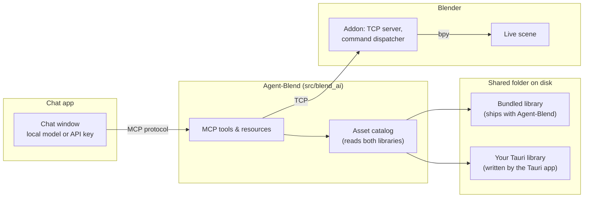
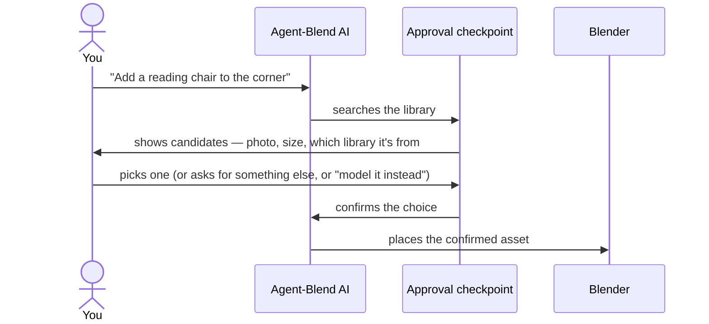

# Blender MCP × Asset Library Integration Plan

**In one sentence:** we're connecting Agent-Blend (the AI that controls Blender) to the same 3D asset library that the RealWorks desktop app builds, and wrapping the whole thing in a chat app that stops and asks "which one do you want?" before it touches your scene.

| | |
|---|---|
| **Status** | Proposal — architecture agreed, build not started |
| **Owner** | Agent-Blend |
| **Audience** | Anyone — Part 1 needs no technical background; Parts 2 onward are for engineers |
| **Last updated** | 2026-08-08 |

---

## Contents

- [Part 1 — In plain terms](#part-1--in-plain-terms)
- [Part 2 — Where things stand today](#part-2--where-things-stand-today)
- [Part 3 — Making the two libraries one](#part-3--making-the-two-libraries-one)
- [Part 4 — Target architecture](#part-4--target-architecture)
- [Part 5 — The human approval step](#part-5--the-human-approval-step)
- [Part 6 — The chat app](#part-6--the-chat-app)
- [Part 7 — Risks and constraints](#part-7--risks-and-constraints)
- [Part 8 — Build order](#part-8--build-order)
- [Part 9 — Decisions already locked in](#part-9--decisions-already-locked-in)
- [Glossary](#glossary)

---

## Part 1 — In plain terms

Two things already exist separately, and this plan connects them.

**The first thing** is Agent-Blend: you type what you want in plain English — "add a queen bed and two nightstands to this bedroom" — and it drives a real, running copy of Blender to actually build it. It's genuinely good at this, but when it needs furniture, it either builds a rough approximation out of basic shapes, or reaches into a small starter library of about 90 pre-made pieces that ship with the project.

**The second thing** is a separate desktop app (built with Tauri) that some of you already use: you drag a 3D file into it — downloaded from anywhere, in almost any format — and it cleans it up, fixes broken materials and missing textures, figures out what category it belongs in, and files it away in a personal, ever-growing library on your computer.

Right now, Agent-Blend has no idea that second library exists. This plan closes that gap: **Agent-Blend learns to search and pull from your real, growing personal library**, not just its small built-in starter set.

**But there's a second, more important part of this plan.** Today, if you ask Agent-Blend for a chair, it just picks one and puts it in the scene — no questions asked. That's fine when the library has 90 hand-picked items. It stops being fine once it's searching *your* library, which might have three different chairs that all technically match "chair." So we're adding a checkpoint: whenever the AI finds candidates in the library, **it stops and shows them to you — pictures, sizes, everything — and waits for you to pick one, ask for something else, or say "just model it instead"** before it changes anything in your scene. This is the "human in the loop" idea the whole plan is built around: the AI does the searching and the building, but a person always makes the actual selection call.

Finally, all of this needs a home to run in — a proper chat window, not just a command-line prompt. That chat app needs to work whether you're running a model entirely on your own computer (no internet, no cost, more private) or plugging in an API key to use a more capable hosted model. We're not building that chat app's plumbing from scratch — we're building it on top of an existing, well-tested open-source foundation (more on why in [Part 6](#part-6--the-chat-app)) and focusing our own effort on the one piece that doesn't exist anywhere off the shelf: that asset-picker checkpoint.

**What doesn't change:** your existing personal library keeps living exactly where it is, in exactly the format the Tauri app already writes it in. Nothing about how that app works is touched. Agent-Blend just learns to read from it.

---

## Part 2 — Where things stand today

Both systems are real, working software today. Neither one currently knows the other exists.

| | Agent-Blend's built-in library | Your Tauri app's library |
|---|---|---|
| **What it is** | ~90 curated assets shipped inside the project | Your personal library, grows every time you convert something |
| **Where it lives** | Inside the Agent-Blend project folder (`asset_library/`) | Wherever you configured it — a folder on your own disk |
| **Folder shape** | `<category>/<item>/model.glb` + `metadata.json` | `<Category>/<name>/asset.usd` + `thumbnail.png` + `textures/` + `metadata.json` (+ optional `asset_profile.json`) |
| **3D file format** | `.glb` | `.usd` |
| **How it's described** | Hand-written metadata: category, real-world size, which way it faces, what surface it sits on, what it relates to (e.g. "rests on a bed") | Machine-written by the conversion pipeline: category, tags, source format. Spatial/placement detail (size, orientation, what it pairs with) lives in a separate, AI-optional file |
| **Preview images** | None — nothing to show in a picker today | Always has a thumbnail |
| **Used by** | Agent-Blend's `search_asset_library` / `import_asset` tools, already wired into its "always check the library first" behavior | Only the Tauri app's own screen, today |

The reassuring part: the Tauri app's optional richer file (`asset_profile.json` — real-world width/depth/height, which way the object faces, whether it sits on the floor or a wall or a tabletop, what it pairs with) describes almost exactly the same things Agent-Blend's own metadata already describes. **This isn't two unrelated systems that need to be reconciled from scratch — it's the same idea, written down twice, independently, by two different tools.** That's what makes joining them tractable.

One more piece of good news that removes a whole category of risk: Blender's addon **already knows how to import `.usd` files** (`bpy.ops.wm.usd_import`, wired into `addon/handlers/file_ops.py`). Nothing in Blender itself needs to change to place an asset that came from the Tauri app's library.

---

## Part 3 — Making the two libraries one

### The core decision: an adapter, not a rewrite

We extend Agent-Blend's existing asset catalog (`src/blend_ai/asset_catalog.py`) to read from **two folders instead of one**:

1. The bundled library, as it works today (unchanged).
2. Your Tauri library's folder, added as a second source.

Each asset gets tagged with which library it came from, and IDs are kept unique across both (for example `bundled:seating/stool` vs. `user:Furniture/oak-chair`) so there's never a collision even if both libraries happen to have something called "chair."

### Mapping one schema onto the other

| Tauri library field | Maps to |
|---|---|
| `metadata.json` → `id`, `name`, `category`, `tags` | Asset identity and search terms |
| `metadata.json` → `asset_path` (`asset.usd`) | The file Blender actually imports |
| `metadata.json` → `thumbnail` | The picture shown in the human-approval step ([Part 5](#part-5--the-human-approval-step)) |
| `asset_profile.json` → geometry (width/depth/height in mm) | Real-world size, same field Agent-Blend already uses to place things without guessed coordinates |
| `asset_profile.json` → orientation, placement rules, relationships | Which way it faces, floor/wall/tabletop, what it rests on or pairs with |
| *(if `asset_profile.json` doesn't exist — AI tagging was off during conversion)* | Falls back to "needs review" and a safe default. This isn't a hard failure: Agent-Blend already re-measures the real size and position from Blender itself after import, so a missing profile only reduces placement confidence, not correctness. |

### What we're deliberately *not* doing

- **Not** reading the Tauri app's internal database (`library.db`) directly. Its own documentation is explicit that the database is disposable, rebuildable state and the files on disk are the real record — so we treat the filesystem as the source of truth too, exactly the same assumption Agent-Blend's own catalog already makes. This also means the two apps never need to touch each other's internals, and neither has to be running for the other to work.
- **Not** moving or converting the bundled 90-asset library into the Tauri format, or vice versa. The adapter makes that unnecessary, and the bundled library needs to keep working with zero setup, independent of whether anyone has the Tauri app installed at all.

---

## Part 4 — Target architecture

The only connection between Agent-Blend and the Tauri app is the folder on disk. Neither app needs to be running for the other to work, and neither reaches into the other's internal state — the filesystem is the entire handshake.

**A limit worth knowing up front:** Blender's addon accepts one connection at a time. Two chat sessions (or a chat session and the older terminal-based REPL) can't drive the same Blender window at once — the second one needs to see a clear "already connected" message, not a silent hang.

---

## Part 5 — The human approval step

This is the part that genuinely doesn't exist anywhere off the shelf, and it's the reason we can't just plug a generic MCP chat client in and call it done.

Today, Agent-Blend's instructions tell the AI: search the library, then immediately place the best match. That's exactly the behavior we're interrupting. The newest version of the MCP protocol has a built-in way for a tool to pause and ask the person a question mid-call (called *elicitation*), but almost no chat clients support it reliably yet — so rather than depend on something still maturing, we build the pause ourselves, at the level of the chat app's own conversation loop.

The checkpoint only fires when the AI is about to **pick an asset from the library** — it doesn't interrupt every single action the AI takes (that would make it unbearable to use). Everything else — moving objects, setting up lighting, adjusting materials, taking a screenshot to check its own work — keeps happening automatically, the way it does today.

---

## Part 6 — The chat app

The parts of a chat app that have nothing to do with 3D — message history, streaming responses, switching between a local model and an API key — are solved problems. Building all of that from zero would mean spending effort on the 80% that's identical to every other chat app ever built, instead of the 20% that's actually specific to this project (the approval checkpoint above).

| Option | Understands MCP natively | Has a built-in "approve this" UI pattern | Works with local models and API keys | How hard to add a custom picture-picker |
|---|---|---|---|---|
| **Chainlit — chosen** | Yes | Yes — action buttons and custom visual elements | Yes, directly | Easy — it's Python, same language as the rest of this project |
| LibreChat | Yes | Only a generic "here's the tool result" view, not a picker | Yes | Hard — separate React/database stack |
| Open WebUI | Only through an extra add-on | No | Yes | Hard — thin plugin surface |
| A desktop MCP client (e.g. 5ire) | Yes | No | Yes | Hard — not built to be customized |
| Building it ourselves | We'd write it | We'd write it | We'd write it | Total control, but months of avoidable plumbing work |

**Chainlit wins because it's Python.** Agent-Blend's whole server is already Python, and its existing terminal chat prototype (`ollama_chat.py`) already has almost all the logic this needs — talking to a model, running tool calls, showing screenshots. Moving that logic into Chainlit's message handlers is adaptation, not a rewrite. Its "action button" and "custom element" building blocks are close to exactly what an asset picker needs, and because it speaks MCP natively, the result is a genuinely general-purpose chat app — usable with other MCP tools later, not something permanently welded to Blender.

---

## Part 7 — Risks and constraints

| Risk | What it means in practice |
|---|---|
| **One Blender connection at a time** | Two people (or two tabs) can't drive the same Blender window simultaneously — needs a clear error, not a silent freeze |
| **The Tauri app might be mid-conversion while we're reading its folder** | A partially-written asset must be skipped, not crash the search — the same safety check the bundled library already uses for incomplete entries |
| **`.usd` import is wired in but not yet proven against real converted assets** | Needs a real smoke test — import a few actual Tauri-converted files and confirm materials and textures survive — before calling this "supported" rather than "should work" |
| **The bundled library has no thumbnails** | Tauri assets get a picture in the approval step for free; the 90 bundled ones don't yet. Needs a one-time thumbnail generation pass so both sources look consistent side by side |
| **Supporting both local models and API keys** | The current prototype only knows how to talk to one local-model provider. Needs a small, deliberately narrow adapter layer — not a "support every provider" rewrite |
| **The "ask the human" protocol feature is still new** | Building the checkpoint ourselves now, with a plan to switch to the official protocol mechanism once more chat clients support it |

---

## Part 8 — Build order

Each step is independently checkable — you can confirm it works before moving to the next one, rather than discovering a problem only once everything is wired together.

**1. Teach the catalog to read both libraries.**
Add the second folder, tag each asset by source, keep IDs unique across both, write the field-mapping from [Part 3](#part-3--making-the-two-libraries-one). Guard against a folder the Tauri app is still writing to, the same way the bundled library already guards against incomplete entries.

**2. Prove it with the existing terminal chat.**
Point Agent-Blend at a real Tauri library, ask it to place one of those assets, and confirm the `.usd` file imports cleanly with materials intact — before building any new interface. This is the cheapest place to catch a surprise.

**3. Pull the conversation loop out into its own reusable piece.**
Same logic that already exists in the terminal prototype, just no longer tied to typing directly into a terminal.

**4. Add the approval checkpoint inside that loop.**
When a library search returns candidates, the loop stops and waits for an external answer before continuing — provable with a scripted test before any visual interface exists.

**5. Stand up the Chainlit chat app.**
Wire step 3 into it. Two provider options to start: a local model (no key needed) and one API-key provider. Connect to Agent-Blend as a real, independent MCP server, not bundled into the same process.

**6. Build the actual picker.**
Thumbnail grid, real-world size, which library it came from, "none of these" and "show more" options — wired to the checkpoint from step 4. Generate the missing thumbnails for the bundled library so both sources look the same in the picker.

**7. Harden the rough edges.**
Clean "already connected" handling for the single-Blender-connection limit, and a documented way to run all of this alongside the existing install instructions.

---

## Part 9 — Decisions already locked in

These aren't open questions anymore — they're the specific choices this plan is built around, so future work doesn't re-litigate them:

- **Library path configuration:** a single environment variable pointing at the Tauri library folder, matching the pattern the bundled library already uses. No settings screen for this in v1.
- **Chat framework:** Chainlit (see [Part 6](#part-6--the-chat-app)).
- **Model providers for v1:** a local model via Ollama, and one hosted API-key provider (Anthropic). Nothing else in scope for the first version — more providers can be added later without redesigning the adapter.
- **The bundled 90-asset library stays.** It's not replaced by the Tauri integration — it remains the zero-setup default, with the Tauri library added alongside it, not instead of it.

---

## Glossary

*For anyone who wants Part 2 onward without looking anything up.*

- **MCP (Model Context Protocol):** the standard way an AI assistant calls out to external tools — in this case, the tools that actually move objects around in Blender. Think of it as the AI's set of hands; without it, the AI could only describe what it would do, not do it.
- **Asset catalog:** the piece of code that knows how to look inside a library folder and turn what it finds into a searchable list.
- **USD / glTF (`.usd` / `.glb`):** two different standard file formats for storing a 3D object. Different tools historically preferred different formats — part of what this integration handles is that Blender needs to be able to open both.
- **Metadata:** the descriptive information *about* a 3D object — its category, size, which way it faces — stored alongside the object itself, separate from the 3D geometry.
- **Human-in-the-loop:** a design where an automated system pauses at a specific decision point and waits for a person to confirm or choose, rather than deciding everything on its own.
- **Orchestrator / conversation loop:** the part of the chat app that manages back-and-forth between you, the AI model, and the tools it calls — deciding what happens next after each message.
- **Elicitation:** the formal name for a tool being able to pause mid-action and ask the person using it a question, as part of the MCP standard itself.
- **Provider:** whichever AI model is actually answering — could be one running on your own computer (a "local model") or one running on someone else's servers that you access with an API key.

---

*Sources: Agent-Blend's `src/blend_ai/` and `addon/`; the RealWorks 3D Asset Library & Converter's `OVERVIEW.md` and `DOCUMENTATION.md`.*
